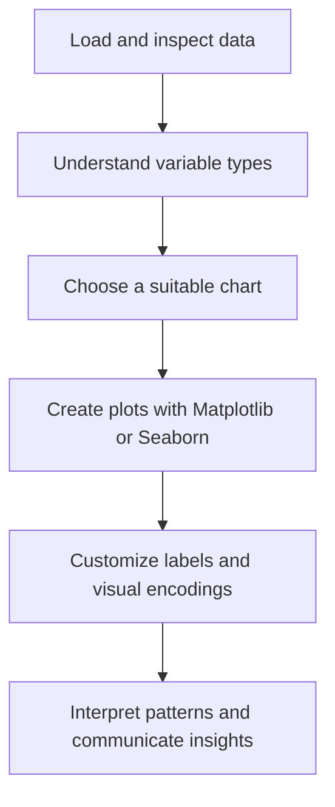

::: {align="center"}
# 📊 Data Visualization with Python

### Turning raw data into clear, meaningful insights.

**A hands-on learning repository for Matplotlib, Seaborn, and
exploratory data visualization.**

[](https://www.python.org/)
[](https://jupyter.org/)
[](https://matplotlib.org/)
[](https://seaborn.pydata.org/)

`<br/>`{=html}

[Explore Notebooks](#-notebooks) • [Getting Started](#-getting-started)
• [Learning Outcomes](#-what-youll-learn)
:::

------------------------------------------------------------------------

## ✨ About the Project

Data visualization helps transform raw numbers into patterns, trends,
and insights that are easier to understand. This repository brings
together practical **Jupyter Notebook** examples to build a foundation
in Python visualization.

You'll explore chart creation, plot customization, and relationships
between variables using **Matplotlib** and **Seaborn**---two essential
tools for data analysis, data science, and machine learning workflows.

> **Project goal:** Learn by doing, experiment with plots, and build
> confidence in communicating data visually.

## 🧭 Notebooks

  ---------------------------------------------------------------------------------------------------------------------------------------------------------------------
  Notebook                What it covers          Open
  ----------------------- ----------------------- ---------------------------------------------------------------------------------------------------------------------
  **Matplotlib**          Data types, line plots, [Open
                          plot titles and labels, notebook](https://github.com/mdaamir6870/Data-Visualisation-Deatails/blob/main/Copy_of_session_23_matplotlib.ipynb)
                          multiple plots, and     
                          bivariate analysis      

  **Seaborn**             Scatter plots,          [Open notebook](https://github.com/mdaamir6870/Data-Visualisation-Deatails/blob/main/Seaborn.ipynb)
                          relationship plots,     
                          categorical encodings   
                          with `hue` and `style`, 
                          and the `tips` dataset  
  ---------------------------------------------------------------------------------------------------------------------------------------------------------------------

### 🚀 Run the notebooks in Google Colab

No local setup required---open a notebook and run the cells
interactively.

::: {align="center"}
[](https://colab.research.google.com/github/mdaamir6870/Data-Visualisation-Deatails/blob/main/Copy_of_session_23_matplotlib.ipynb)

[](https://colab.research.google.com/github/mdaamir6870/Data-Visualisation-Deatails/blob/main/Seaborn.ipynb)
:::

## 🧠 What You'll Learn

-   **Visualization fundamentals:** Understand numerical and categorical
    data.
-   **Matplotlib basics:** Create line charts, compare series, and add
    titles, labels, and axes.
-   **Seaborn relationships:** Explore relationships between numerical
    variables with scatter plots and `relplot()`.
-   **Categorical comparisons:** Use `hue` and `style` to distinguish
    groups within a chart.
-   **Exploratory data analysis (EDA):** Use visual patterns to ask
    better questions about data.
-   **Communication:** Make charts more readable and useful for
    explaining findings.

## 🛠️ Technology Stack

  Tool                   Role
  ---------------------- -----------------------------------------------
  **Python**             Core programming language
  **Jupyter Notebook**   Interactive code and explanations
  **NumPy**              Numerical operations
  **Pandas**             Data handling and tabular analysis
  **Matplotlib**         Flexible chart creation and customization
  **Seaborn**            Statistical visualization built on Matplotlib

## 📁 Repository Structure

``` text
Data-Visualisation-Deatails/
├── Copy_of_session_23_matplotlib.ipynb  # Matplotlib examples
├── Seaborn.ipynb                         # Seaborn examples
└── README.md                             # Project documentation
```

## ⚙️ Getting Started

### 1. Clone the repository

``` bash
git clone https://github.com/mdaamir6870/Data-Visualisation-Deatails.git
cd Data-Visualisation-Deatails
```

### 2. Create and activate a virtual environment (recommended)

**Windows PowerShell**

``` powershell
python -m venv .venv
.\.venv\Scripts\Activate.ps1
```

**macOS / Linux**

``` bash
python3 -m venv .venv
source .venv/bin/activate
```

### 3. Install the dependencies

``` bash
python -m pip install numpy pandas matplotlib seaborn jupyter
```

### 4. Launch Jupyter Notebook

``` bash
jupyter notebook
```

Open either notebook and run its cells in order.

## 💻 Example: Visualizing Tips

The following example creates a scatter plot to explore the relationship
between a customer's total bill and tip amount.

``` python
import seaborn as sns
import matplotlib.pyplot as plt

tips = sns.load_dataset("tips")

sns.relplot(
    data=tips,
    x="total_bill",
    y="tip",
    kind="scatter"
)

plt.show()
```

**Interpretation tip:** A visualization can reveal patterns, clusters,
and possible outliers. Always interpret what you see in context; a
relationship between two variables does not, by itself, prove causation.

## 🗺️ Learning Workflow



## 🔭 Future Enhancements

Ideas for expanding this repository:

-   Add histograms, bar charts, box plots, and heatmaps.
-   Include correlation analysis and distribution plots.
-   Add real-world datasets and end-to-end EDA case studies.
-   Save selected chart outputs in a dedicated `images/` folder.
-   Add a `requirements.txt` file for reproducible setup.

## 👤 Author

**Md Aamir**\
*MSc Data Science \| Data Science & Generative AI Enthusiast*

-   **GitHub:** [@mdaamir6870](https://github.com/mdaamir6870)

## 🤝 Feedback & Contributions

Found an improvement or want to add a visualization example? Feel free
to open an issue or submit a pull request.

If this repository helps you learn, consider giving it a ⭐ on GitHub!

------------------------------------------------------------------------

::: {align="center"}
**Learn • Visualize • Analyze • Communicate**
:::
